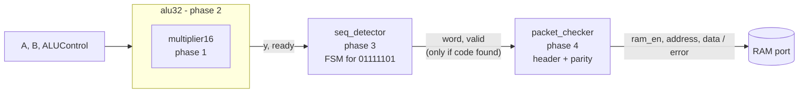
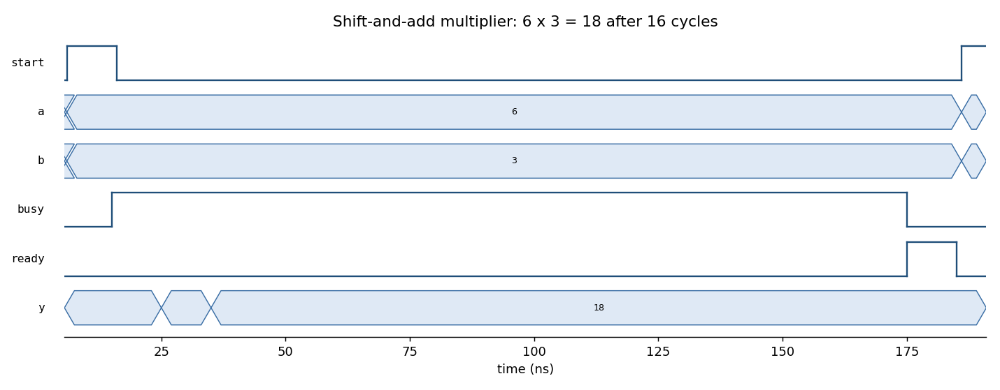
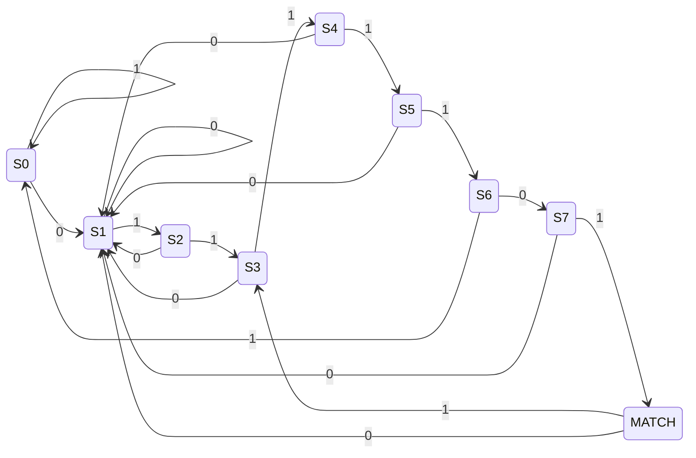
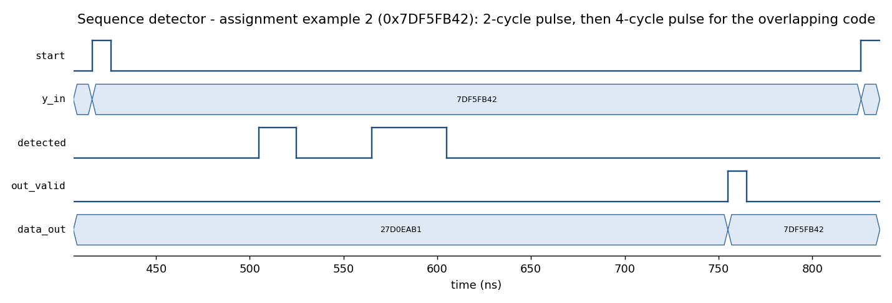
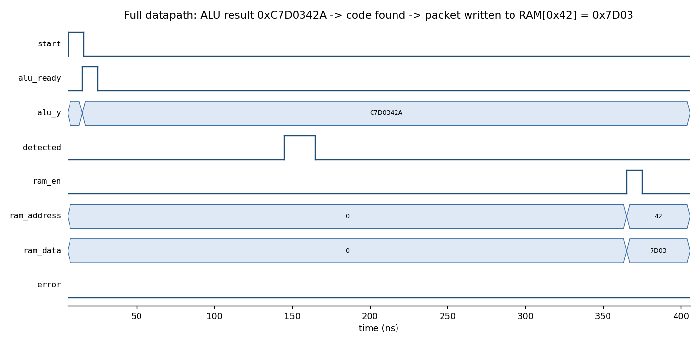

# 32-bit ALU Datapath in VHDL: Multiplier, ALU, FSM Sequence Detector and Packet Checker

This is a synthesisable VHDL datapath built in four phases, plus a bonus timer, for the Logic Circuits course project. Each block has a **self-checking testbench**, with **6000+ assertions** covering every example in the assignment sheets, regression cases and randomised tests against a reference model. The design is verified in **Vivado XSim** and synthesised for an Artix-7 FPGA.

> **Course:** Logic Circuits (Prof. Shariatmadar), final project, Amirkabir University of Technology, Spring 2024.



| Phase | Module | What it does |
|---|---|---|
| 1 | [`multiplier16`](rtl/multiplier16.vhd) | 16 × 16 → 32-bit unsigned **shift-and-add** multiplier (16 cycles, start/ready handshake) |
| 2 | [`alu32`](rtl/alu32.vhd) | 32-bit ALU with **NOP, ADD, SUB, MULT, SLT, AND, OR, XOR** and **C / O / N / Z** flags, reusing the phase-1 multiplier |
| 3 | [`seq_detector`](rtl/seq_detector.vhd) | **Moore FSM** that scans the ALU result serially for the code `0111 1101` (0x7, 0xD), including **overlapping** occurrences |
| 4 | [`packet_checker`](rtl/packet_checker.vhd) | Parses the word as a packet (header 0xA, 8-bit address, 16-bit data, 4 **even-parity** check bits) and drives a RAM write port or an error flag |
| top | [`datapath_top`](rtl/datapath_top.vhd) | Connects the four phases into one pipeline |
| bonus | [`countdown_timer`](rtl/countdown_timer.vhd) | Minutes:seconds countdown timer from a 50 MHz clock, with a synchronous active-low reset |

## Design notes

### Phase 1: Multiplier
On `start`, the low 16 bits of the operands are loaded and the product is cleared. In each of the next 16 cycles, the multiplicand is added to the product when the multiplier's LSB is 1. Then the multiplicand shifts left and the multiplier shifts right. `ready` pulses for one cycle when the product is valid.



### Phase 2: ALU
| ALUControl | Operation | Flags |
|---|---|---|
| `000` | NOP: Y = 0 | none |
| `001` | ADD (two's complement) | C (carry-out), O (signed overflow), N, Z |
| `010` | SUB, computed as A + ¬B + 1 | C (= no borrow), O, N, Z |
| `011` | MULT of the low 16 bits (unsigned), via `multiplier16` | Z (no overflow is possible, since 16 × 16 bits fit in 32) |
| `100` | SLT: signed A < B | none |
| `101` / `110` / `111` | AND / OR / XOR | none |

Overflow is detected as *both operands have the same sign and the result's sign differs*. All flags and `ready` are valid for exactly one clock cycle, as the specification requires. Single-cycle operations finish one cycle after `start`, and MULT after 18.

### Phase 3: Sequence detector (FSM)
The state is the length of the longest prefix of `01111101` matched so far, so the states form a KMP-style automaton. After a full match, the suffix `01` is already the start of the next possible occurrence, so overlapping codes are found without re-scanning:



`detected` is high for 2 clocks after each occurrence, or for 4 clocks when an occurrence overlaps the previous one (the bonus part). Only words that contain the code are forwarded to phase 4. The waveform below is assignment example 2:



### Phase 4: Packet checker
| Bits | 31–28 | 27–24 | 23–20 | 19–16 | 15–12 | 11–4 | 3–0 |
|---|---|---|---|---|---|---|---|
| Field | check | Data4 | Data3 | Data2 | Data1 | Address | Header = `1010` |

Check bit 31 is the even parity of Data4, bit 30 of Data3, and so on down to bit 28 for Data1. A valid packet gives a one-cycle `ram_en` pulse with the address and data. A parity mismatch gives a one-cycle `error` pulse, and the checker then waits for the next header. Parity checking can be switched off with the `PARITY_CHECK` generic.

### Whole pipeline


## Verification
`python sim/run_tests.py` compiles everything and runs all testbenches. It uses Vivado XSim, or GHDL if that is installed instead.

```
ok   tb_multiplier16        PASS multiplier16 (1035 checks)
ok   tb_alu32               PASS alu32 (4988 checks)
ok   tb_seq_detector        PASS seq_detector (16 checks)
ok   tb_packet_checker      PASS packet_checker (9 checks)
ok   tb_datapath_top        PASS datapath_top (5 checks)
ok   tb_countdown_timer     PASS countdown_timer (8 checks)

6/6 testbenches passed
```

| Testbench | Coverage |
|---|---|
| `tb_multiplier16` | Corner cases (0, 1, 65535²), garbage in the upper operand bits, back-to-back operations, 200 random products. Checks latency = 16 cycles and that `ready` lasts one cycle. |
| `tb_alu32` | All 9 examples from the assignment sheet, signed edge cases, and 1200 random ADD/SUB/SLT/XOR plus 30 random MULT operations against a reference model. Checks that flags last one cycle. |
| `tb_seq_detector` | Both assignment examples bit by bit, words with no match, a code in the last byte, and two separate codes |
| `tb_packet_checker` | All 3 assignment examples (with and without parity checking), a wrong header, back-to-back packets |
| `tb_datapath_top` | End-to-end: valid packet → RAM write, parity error, a word without the code that is not forwarded |
| `tb_countdown_timer` | 0:03, the 2:45 example (including minute roll-over), 0:00, reset during a countdown |

## Synthesis (Vivado 2025.2, xc7a35t, 100 MHz)
`vivado -mode batch -source sim/synth.tcl` synthesises `datapath_top`:

| LUTs | Flip-flops | DSPs | Worst negative slack @ 10 ns |
|---:|---:|---:|---:|
| 262 | 301 | 0 | +5.09 ns (post-synthesis estimate, about 200 MHz) |

The multiplier is built from logic only, with no DSP slices, as the shift-and-add specification intends. The course targeted a Spartan-6 XC6SLX9 under ISE. The RTL uses plain VHDL-93 and `numeric_std`, so it is portable; the testbenches use VHDL-2008.

## Changes compared with the original course submission
Rewriting the blocks against self-checking tests uncovered these problems in the 2024 version:

| Block | Problem in the original | Fixed |
|---|---|---|
| Multiplier | The counter was never reset on `start`, so it multiplied **only once after power-up**. The product was not cleared either. | Clears and reloads on every `start`; back-to-back operations are tested. |
| ALU | SLT compared the two's-complement values as unsigned, so **5 < −3 returned true**. | Signed comparison. |
| ALU | MULT used the `*` operator, assigning a 64-bit product to a 32-bit signal (a width error) and bypassing the phase-1 multiplier. | MULT uses `multiplier16`, as the specification requires. |
| ALU | Every operation took 32 cycles because of a free-running counter. | 1 cycle (18 for MULT). |
| ALU | `std_logic_unsigned` and `numeric_std` were mixed. | `numeric_std` only. |
| Packet checker | A one-bit `counter` locked up after the first packet, so **only one packet was ever processed**. | Every valid strobe is processed. |
| Sequence detector | 9 states plus three extra flags and counters, with no forwarding interface to phase 4. | A clean KMP-style FSM with a `valid` handshake. |
| Testbenches | Stimulus only, checked by eye. One was an empty ISE template. | Self-checking, with 6000+ assertions. |
| Bonus timer | Not implemented. | Implemented and tested. |

## Running it
```bash
python sim/run_tests.py --vivado <Vivado>/bin   # or put xvhdl/xelab/xsim (or ghdl) on PATH
python sim/run_tests.py --vivado <Vivado>/bin --vcd && python sim/plot_waves.py   # regenerate the waveforms
vivado -mode batch -source sim/synth.tcl        # synthesis reports in sim/build/
```

## Skills
VHDL (RTL and VHDL-2008 testbenches) · FSM design · datapath and control · computer arithmetic (two's complement, overflow, shift-add multiplication) · self-checking verification · Vivado XSim and synthesis · Python tooling

## Author
**Sepehr Ebrahimi**, B.Sc. Electrical Engineering, Amirkabir University of Technology (2026)
